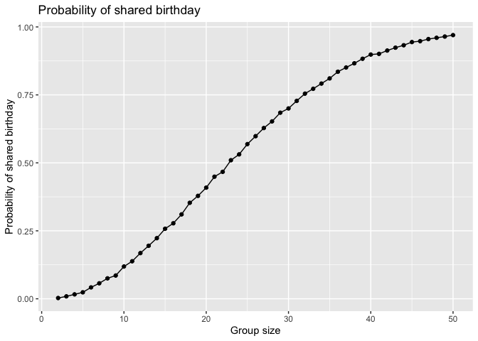

p8105_hw5_hca2124
================
Helene Apollon
2026-11-17

``` r
library(tidyverse)
```

    ## ── Attaching core tidyverse packages ──────────────────────── tidyverse 2.0.0 ──
    ## ✔ dplyr     1.2.1     ✔ readr     2.2.0
    ## ✔ forcats   1.0.1     ✔ stringr   1.6.0
    ## ✔ ggplot2   4.0.3     ✔ tibble    3.3.1
    ## ✔ lubridate 1.9.5     ✔ tidyr     1.3.2
    ## ✔ purrr     1.2.2     
    ## ── Conflicts ────────────────────────────────────────── tidyverse_conflicts() ──
    ## ✖ dplyr::filter() masks stats::filter()
    ## ✖ dplyr::lag()    masks stats::lag()
    ## ℹ Use the conflicted package (<http://conflicted.r-lib.org/>) to force all conflicts to become errors

\#Question 1

``` r
bdays = sample(1:365, 25, replace = TRUE)

length(unique(bdays)) < 25
```

    ## [1] TRUE

``` r
bday = function(n) {
  if (!is.numeric(n)) {
    stop("n must be numerical")
  } else if (n<2) {
    stop("group has at least 2 ppl")
  }
  
  bdays = sample (1:365, n, replace = TRUE)
  
  any(duplicated(bdays))
}

bday(10)
```

    ## [1] TRUE

``` r
bday(50)
```

    ## [1] TRUE

``` r
bday_function_df =
  expand.grid(
    group_size = 2:50,
    iter = 1:10000
  ) |>
  mutate(
    shared = map_lgl(group_size, bday)
  )

prob_df =
  bday_function_df |>
  group_by(group_size) |>
  summarise(prob_shared = mean(shared))
```

``` r
prob_df |>
  ggplot(aes(x = group_size, y = prob_shared)) +
  geom_point() +
  geom_line() +
  labs(
    title = "Probability of shared birthday",
    x = "Group size",
    y = "Probability of shared birthday"
  )
```

<!-- -->
The probability of a shared birthday rises steadily as group size
increases. It reaches 50% probability at around a group size of 23 and
increases to 96% probability at a group size of 48 and plateaus
afterwards.
